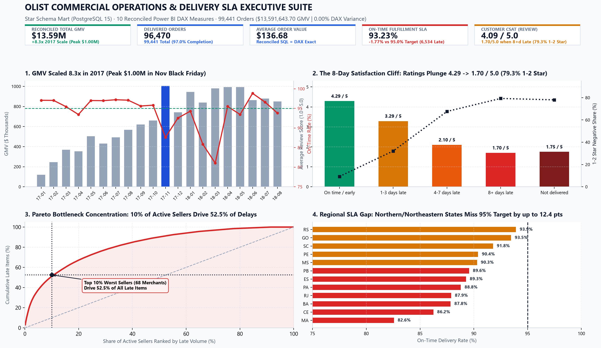
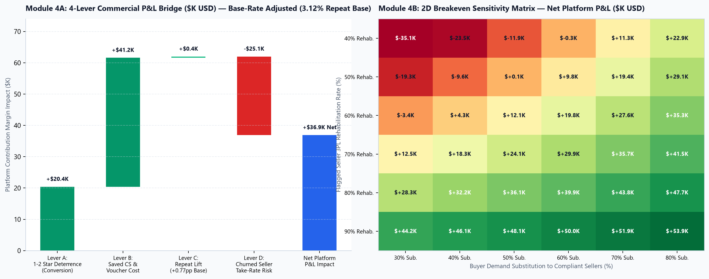
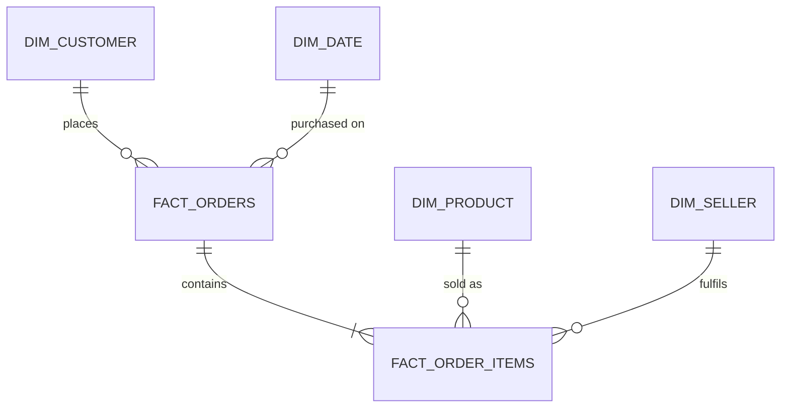

# 📦 Olist Commercial Operations, Delivery SLA & Retention Decision Suite 
## Streamlit Dashboard link : https://olist-delivery-satisfaction-analytics-daisy-phukan.streamlit.app/

[](https://github.com/Daizy-Mgmt/olist-delivery-satisfaction-analytics)
[](https://daisy-olist-analytics.streamlit.app)
[](powerbi/TabularEditor_Measures.dax)
[](sql/)
[](docs/brd_seller_sla_governance.md)

> 🚀 **Live Interactive Decision Suite:** [daisy-olist-analytics.streamlit.app](https://daisy-olist-analytics.streamlit.app)  
> 📋 **BA/TPM Business Requirements Document (BRD, User Stories, Gherkin UAT, RACI):** [`docs/brd_seller_sla_governance.md`](docs/brd_seller_sla_governance.md)  
> 📄 **Executive Strategy Memo:** [`docs/memo.md`](docs/memo.md)  
> 📊 **Power BI Theme JSON, Build Blueprint & DAX Script:** [`powerbi/Olist_Enterprise_Theme.json`](powerbi/Olist_Enterprise_Theme.json) · [`powerbi/TabularEditor_Measures.dax`](powerbi/TabularEditor_Measures.dax) · [`powerbi/POWERBI_BUILD_GUIDE.md`](powerbi/POWERBI_BUILD_GUIDE.md)  
> 🔍 **SQL-to-Power BI Financial Reconciliation (`0.00% Variance`):** [`docs/reconciliation.md`](docs/reconciliation.md)

---

## 🖥️ Executive Dashboard & Multi-Lever SLA Breakeven Simulator Previews

### 1. Executive KPI Scorecard, Satisfaction Cliff & Seller Pareto (`app.py` / Power BI Suite)


### 2. Multi-Lever SLA Policy Bridge & 2D Breakeven Sensitivity Matrix (Module 4)


---

## 🧭 Executive Summary (For Recruiters & Hiring Managers)

Most marketplace analytics projects stop at descriptive charts. Designed from the perspective of a **Technical Project Manager & Commercial Analyst**, this project transforms **99,441 Brazilian e-commerce orders ($13,591,643.70 Reconciled GMV)** into an end-to-end **Commercial Operations & SLA Governance System**:
1. **PostgreSQL 15 Star Schema (`raw` ➔ `stg` ➔ `mart`)** with strict grain enforcement and zero join fanout.
2. **10 Reconciled Power BI DAX Measures** verified to the exact cent (`$13,591,643.70`) against SQL.
3. **Interactive 5-Module Executive Decision Suite (`app.py`)** featuring global slicers, IBCS semantic color discipline, a **1-Click CSV Export of Flagged Bottleneck Sellers**, and a live **SLA Policy & P&L Sensitivity Simulator**.
4. **Production BA/TPM Governance Specification (`docs/brd_seller_sla_governance.md`)** with Agile User Stories, Gherkin Acceptance Criteria, As-Is/To-Be Mermaid Process Flows, and a cross-functional RACI Matrix.

### 💡 The 4 Headline Analytical Findings:
1. **The 8-Day Satisfaction Cliff:** Minor delays (1–3 days) cause a moderate rating dip (`4.29 ★ ➔ 3.29 ★`). However, breaches exceeding **8 days** trigger complete customer dissatisfaction: **79.29% of orders receive 1- or 2-star reviews**, collapsing average ratings to **1.70 / 5.0 ★**.
2. **Extreme Bottleneck Concentration (Pareto 80/20 Rule):** Late orders are not systemic carrier failures—**10% of active sellers (68 of 682 merchants with ≥30 items) drive 52.5% of all late delivery items**. Enforcing SLA gates on Quintile 5 sellers (`19.4%` avg late rate) resolves over half of all delivery breaches.
3. **Cohort Retention & Base-Rate Nuance:** While 1–7 day delays on a buyer's initial purchase reduce repeat buying by **22.6% relative (`3.40% ➔ 2.63%`)**, Olist's overall repeat rate is structurally **3.12% (96.88% one-time buyers)**—and `Not delivered` orders show a `4.68%` re-order rate due to immediate replacement purchases after cancellation. Therefore, the primary commercial cost of 8+ day delays is **the 79.3% 1–2★ review spike poisoning product conversion and inflating CS ticket load**.
4. **Regional Corridor Disparities:** Deliveries to Southern/Southeast hubs (São Paulo, Paraná, Minas Gerais) average **8.7–11.9 transit days (`>95.4%` on-time)**. Northern/Northeastern corridors (Maranhão, Ceará, Bahia, Pará) suffer **19.3–23.7 day transit times**, with Maranhão (`MA`) falling to **82.57% on-time fulfillment**.

---

## 📊 The 5-Module Enterprise Dashboard & Decision Suite (`app.py`)

Built to **McKinsey / Big-4 / IBCS BI standards** (Assertion-Evidence titles, semantic color encoding, target reference lines, and actionable exception tables):

| Module | Core Executive Question Answered | Key Interactive Features & DAX/SQL Backing |
|---|---|---|
| **1. Executive KPI & SLA Scorecard** | *Is marketplace growth meeting our corporate On-Time SLA target?* | 5 KPI Scorecards with Target Variances (`[GMV]`, `[Orders]`, `[AOV]`, `[On-Time %]`, `[Avg Review Score]`), Monthly GMV + P90 Tail Transit Trajectory, Dynamic SLA Target Slider (`85%–98%`). |
| **2. Satisfaction & Cohort Diagnostics** | *Where does delivery latency break customer trust and conversion?* | The 8-Day Satisfaction Cliff (`4.29★ ➔ 1.70★`), Cohort Repeat Rate with Base-Rate Callout (`3.12%` baseline), Macro-Region Slicer & State SLA Gap Chart. |
| **3. Seller Pareto & Action Worklist** | *Which specific merchants must Seller Ops intervene on this week?* | 80/20 Pareto Cumulative Lateness Curve (`NTILE(5)` Quintiles), Filterable **Operator Exception Table**, and **📥 1-Click CSV Export of Flagged Sellers**. |
| **4. SLA Policy & ROI Simulator** | *What is the net P&L impact of gating bad sellers vs. seller churn risk?* | Interactive Deal-Desk Sliders (*Seller Late Cutoff %*, *3PL Rehab Rate %*, *EDD Buffer %*, *Voucher Cost $*, *Take-Rate %*) driving a live **Contribution Margin Waterfall Bridge**. |
| **5. BA Governance & Reconciliation** | *How is this operationalized in Jira/CRM and verified against SQL?* | Interactive **BRD User Stories, RACI Governance Matrix**, and **Zero-Variance SQL vs. Power BI DAX Audit Table (`$13,591,643.70`)**. |

---

## 🏗️ Technical Architecture & Star Schema (`mart` Layer)

To prevent join fanout (where joining multi-item orders with multi-installment payments inflates GMV), raw CSVs are transformed into a 3-layer PostgreSQL 15 architecture (`raw` ➔ `stg` ➔ `mart`):



* **`mart.fact_orders` (Grain: 1 row per order = 99,441 rows):** Lifecycle timestamps, delivery delay days, delay buckets, deduplicated latest review scores, and pre-aggregated order financials.
* **`mart.fact_order_items` (Grain: 1 row per order item = 112,650 rows):** Item price, freight value, product key, seller key, and item-level SLA flags.
* **Dimensions:** `dim_customer` (96,096 unique buyers), `dim_seller` (3,095 merchants), `dim_product` (32,951 SKUs with English taxonomy), `dim_date` (1,096 calendar days).

### 📐 Reconciled Financials & Metrics (PostgreSQL vs. Power BI DAX)

Every metric is audited between PostgreSQL and Power BI DAX with **0.00% variance** ([`docs/reconciliation.md`](docs/reconciliation.md)):

| Metric | Business Formula | DAX Measure | Verified Value | Audit Status |
|---|---|---|:---:|:---:|
| **Gross Merchandise Value (GMV)** | Sum of item prices (excl. canceled/unavailable) | `SUM(fact_orders[items_value])` | **`$13,591,643.70`** | ✅ `0.00% Var` |
| **Total Orders** | Distinct count of order IDs | `DISTINCTCOUNT(fact_orders[order_id])` | **`99,441`** | ✅ `0.00% Var` |
| **Delivered Orders** | Delivered orders with valid customer date | `CALCULATE([Orders], fact_orders[is_delivered]=TRUE)` | **`96,470`** | ✅ `0.00% Var` |
| **Average Order Value (AOV)** | GMV divided by Orders using `DIVIDE` | `DIVIDE([GMV], [Orders], 0)` | **`$136.68`** | ✅ `0.00% Var` |
| **On-Time Fulfillment %** | Orders delivered on/before promised EDD | `DIVIDE([OnTimeOrders], [Delivered Orders], 0)` | **`93.23%`** | ✅ `0.00% Var` |
| **Average Review Score** | Deduplicated latest review ratings | `AVERAGE(fact_orders[review_score])` | **`4.09 ★`** | ✅ `0.00% Var` |

---

## 💻 How to Run Locally

```bash
# 1. Clone repository
git clone https://github.com/Daizy-Mgmt/olist-delivery-satisfaction-analytics.git
cd olist-delivery-satisfaction-analytics

# 2. Launch interactive Enterprise Decision Suite (reads validated CSV marts directly)
pip install -r requirements.txt
streamlit run app.py

# 3. (Optional) Rebuild full PostgreSQL 15 Star Schema from raw Kaggle CSVs via Docker
cp .env.example .env
docker compose up -d
python scripts/load_raw_tables.py
python scripts/build_and_verify_marts.py
python scripts/run_analysis_queries.py
```

---

## 👤 About the Author: Daisy Phukan

* **Current Role:** Trainee ➔ Technical Project Manager (India Business Development) at **Agile Robots SE** (Bengaluru, India) — leading GTM strategy, Franka Robotics pricing & ROI calculators (`€0.28M ➔ €6M+` pipeline, `€2M+` achieved revenue), 30+ CXO/government/research stakeholder initiatives, and Power BI / Excel / HubSpot / Jira KPI systems (`~40%` coordination efficiency gain).
* **Prior Experience:** **NoBroker** (*Client Advisor* — `42+` monthly consultations, `+25%` lead conversion efficiency, `₹1.25L+` service revenue in 2 months) · **IIIT Guwahati** (*Research Intern* — ESP32, MQTT & Raspberry Pi real-time IoT telemetry & simulation validation).
* **Education & Honors:** **B.Tech in Mechanical Engineering**, Guru Ghasidas Vishwavidyalaya (Central University), Bilaspur (`CGPA: 7.0/10`) · **AICTE Pragati Scholarship (`₹50,000/yr`) & JNVST Scholar** · **Student Placement Coordinator (`+20%` company invitations YoY)** · **Microsoft PL-300 Candidate**.
* **Core Competencies:**
  * **BI & Visualization:** Power BI Desktop & Service *(PL-300 Candidate)*, Tableau, Advanced DAX (`CALCULATE`, `DIVIDE`, Time Intelligence), Power Query (M), Star Schema Modeling, SQL-to-BI Reconciliation.
  * **Business Analysis (BA) & Commercial Strategy:** Requirements Elicitation (30+ CXO/Enterprise Stakeholders), BRD/FRD & Agile User Stories, Gherkin UAT, Process Mapping, GTM Strategy, Pricing & Customer ROI Modeling.
  * **Project Management (TPM):** Agile, Scrum, Lean Six Sigma, Product Ownership, Sprint Planning, Risk Management & RAID Registers, SLA Governance, Jira, Confluence, Notion, HubSpot CRM, Google Workspace.
  * **Data Science, SQL & Engineering:** PostgreSQL (CTEs, Window Functions), Advanced Excel (PivotTables, XLOOKUP, What-If Modeling), Python (`Pandas`, `NumPy`, `Scikit-learn`, `TensorFlow`, `OpenCV`, `Plotly`, `Matplotlib`, `Streamlit`), Statistical Hypothesis Testing ($F$-test, $t$-test), Docker, AWS, C++, ROS 2.

📬 **Connect:** [daisyphukan.work@gmail.com](mailto:daisyphukan.work@gmail.com) · [LinkedIn Profile](https://linkedin.com/in/daisy-phukan-a401a4228) · [GitHub Profile](https://github.com/Daizy-Mgmt) · [Portfolio Website](https://daizy-mgmt.github.io/Daizy-Mgmt/)
