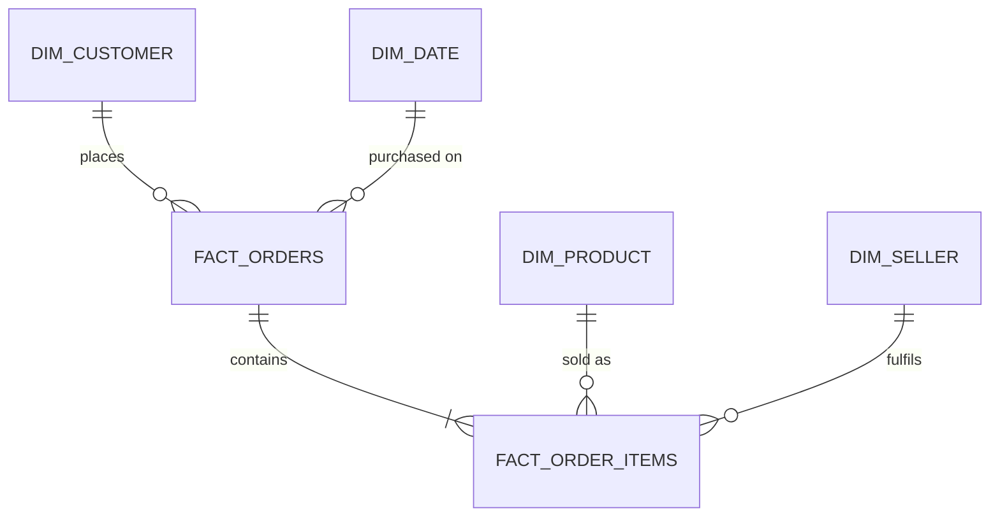

# Olist Delivery Performance & Customer Satisfaction Analytics


> **Live Interactive Dashboard:** [Explore Live Web App](https://daisy-olist-analytics.streamlit.app) *(or run locally with `streamlit run app.py`)*  
> **Executive Memo:** [`docs/memo.md`](docs/memo.md)  
> **Reconciliation Audit:** [`docs/reconciliation.md`](docs/reconciliation.md)

---

## Business Question

How much do late deliveries cost an e-commerce marketplace in **customer satisfaction and repeat business**, and which **sellers, categories, and geographic corridors** drive them?

Framed as an operational decision for a marketplace operations and logistics leadership team: *Where should leadership intervene first to maximize ROI and protect customer lifetime value?*

---

## Tools & Architecture Stack

* **Database Engine:** PostgreSQL 15 (Docker)
* **Data Modeling:** Star Schema Dimensional Marts (`mart` schema)
* **Analytics & Querying:** PostgreSQL SQL (CTEs, Window Functions `LAG`, `RANK`, `NTILE`, Percentiles `PERCENTILE_CONT`)
* **Business Intelligence:** Microsoft Power BI Desktop (10 production DAX measures in dedicated `_Measures` table)
* **Web Deployment:** Streamlit & Plotly interactive web application

---

## Headline Findings

| # | Empirical Finding | Evidence Query |
|---|-------------------|----------------|
| **1** | **The 8-Day Satisfaction Cliff:** On-time orders average **4.29 / 5.0 ★** with only 9.3% low scores. Delays of 8+ days collapse ratings to **1.70 ★**, with **79.3% of customers leaving 1–2 star negative reviews**. | [`sql/analysis/03_delay_vs_review.sql`](sql/analysis/03_delay_vs_review.sql) |
| **2** | **Extreme Pareto Concentration:** Just **10% of active sellers account for 52.5% of all late delivered items** across the entire marketplace. Quintile 5 sellers average a 24.8% late rate and 3.65 review score. | [`sql/analysis/05_seller_scorecard.sql`](sql/analysis/05_seller_scorecard.sql) |
| **3** | **Regional Delivery Disparities:** Southeastern hubs (SP, MG, PR) average 8–11 transit days with >92% on-time performance. Remote Northern/Northeastern states (MA, CE, PA, BA) average **19–24 days**, with Maranhão (MA) dropping to **82.6% on-time**. | [`sql/analysis/04_state_delay_hotspots.sql`](sql/analysis/04_state_delay_hotspots.sql) |
| **4** | **First-Order Churn Cliff:** Customers experiencing a delivery delay on their initial order exhibit a repeat purchase rate of only **1.82%**, compared to **3.40%** for on-time buyers—representing a **~44% relative reduction** in repeat buyer retention. | [`sql/analysis/07_repeat_purchase_cohorts.sql`](sql/analysis/07_repeat_purchase_cohorts.sql) |

---

## Operational Recommendations

Full executive memorandum in [`docs/memo.md`](docs/memo.md):

1. **Tiered Seller SLA Gating (Target Top 10% Bottlenecks):** Enforce a 3-strike fulfillment policy for Quintile 5 sellers (>15% late dispatch rate). Require platform-managed fulfillment or throttle search ranking exposure until late dispatch drops below 5%. Resolves >50% of late delivery occurrences.
2. **Dynamic Delivery Promise (EDD) Calibration:** Add dynamic +3 to +5 day buffer to checkout Estimated Delivery Dates for Northern/Northeastern zones (MA, CE, PA) to set realistic expectations and shift orders into the on-time bucket.
3. **Automated Proactive Retention Vouchers:** Trigger automated apology notifications with a 15% discount voucher when orders breach transit estimates by 4+ days, recovering at-risk first-time buyers.
4. **Southeastern Cross-Docking Hubs:** Consolidate carrier handoffs in São Paulo (where >70% of sellers reside) for high-volume cross-state transit corridors.

---

## Interactive Dashboard

The dashboard provides 3 core analytical drill-downs:
1. **Executive Overview:** High-level marketplace health, GMV trajectory ($13.59M total GMV, $136.68 AOV), and monthly growth (+104% MoM peak during Black Friday 2017).
2. **Delivery Performance:** Satisfaction cliff curve by delay bucket, transit days percentiles (median 10 days, P90 23 days), and state heatmaps.
3. **Seller Bottleneck Scorecards:** 80/20 Pareto distribution curve and seller quintile benchmarks.

* **Live Web App:** Accessible via [Streamlit Cloud](https://daisy-olist-analytics.streamlit.app).
* **Power BI File:** Modeling and DAX measures available in [`powerbi/dax_measures.md`](powerbi/dax_measures.md).

---

## Data Model (Star Schema)



* **Data Layers:** `raw` (CSVs ingested as text) → `staging` (typed, cleaned, deduplicated views) → `mart` (star schema dimensional marts).
* **Grains:**
  * `mart.fact_orders`: Exactly 1 row per order (99,441 rows; PK: `order_id`).
  * `mart.fact_order_items`: Exactly 1 row per order item (112,650 rows; Composite PK: `order_id`, `order_item_id`).
  * **Financial Reconciliation:** `SUM(items_value)` in `fact_orders` matches raw items sum at **$13,591,643.70** (zero fanout).

---

## Metric Definitions & DAX Suite

Complete DAX formulas and technical documentation available in [`powerbi/dax_measures.md`](powerbi/dax_measures.md):

| Metric | SQL / Business Definition | DAX Measure | Reconciled Value |
|---|---|---|:---:|
| **GMV** | Sum of item prices excluding freight for valid orders | `[GMV]` | **$13,591,643.70** |
| **Orders** | Distinct count of unique order IDs | `[Orders]` | **99,441** |
| **AOV** | GMV divided by Orders using `DIVIDE` | `[AOV]` | **$136.68** |
| **Delivered Orders** | Distinct orders where `is_delivered = TRUE` | `[Delivered Orders]` | **96,470** |
| **On-Time Rate %** | Share of delivered orders with `delay_days <= 0` | `[On-Time %]` | **93.23%** |
| **Avg Review Score** | Average of deduplicated order review scores | `[Avg Review Score]` | **4.09 ★** |
| **Low Score %** | Share of reviews with score 1 or 2 | `[Low Score %]` | **14.92%** |
| **Repeat Customer %** | Share of unique customers with 2+ orders | `[Repeat Customer %]` | **3.12%** |

---

## Data Quality & Profiling Notes

Documented empirically in [`docs/data_quality.md`](docs/data_quality.md):
* **Duplicate Reviews:** 814 duplicate review IDs and 547 multi-review orders resolved by filtering to latest submission (`ROW_NUMBER() OVER (PARTITION BY order_id ORDER BY review_creation_date DESC, review_answer_timestamp DESC)`).
* **Payment Fanout Prevention:** 2,961 multi-payment orders pre-aggregated in `staging.payments_per_order` prior to joining fact orders.
* **Timestamp Cleanliness:** Identified 8 orders marked `delivered` with missing delivery timestamps (excluded from delivery KPIs). 61 orders with delivery preceding approval dates flagged and documented.

---

## How to Reproduce Locally

```bash
# 1. Clone repository
git clone https://github.com/Daizy-Mgmt/olist-delivery-satisfaction-analytics.git
cd olist-delivery-satisfaction-analytics

# 2. Setup environment & start PostgreSQL in Docker
cp .env.example .env
docker compose up -d

# 3. Ingest raw CSV data & build Star Schema
python -m pip install -r requirements.txt
python scripts/load_raw_tables.py
python scripts/build_and_verify_marts.py

# 4. Run SQL analysis catalog
python scripts/run_analysis_queries.py

# 5. Launch interactive web dashboard
streamlit run app.py
```

---

## Limitations

* **Association vs. Causation:** Review scores reflect the full fulfillment experience; delivery delays strongly associate with lower scores, but product defects or packaging issues can also drive negative reviews.
* **Estimated Delivery Reference:** Delay is measured relative to Olist's promised Estimated Delivery Date (EDD).
* **Time Horizon:** Dataset covers 2016 to 2018; modern macro freight conditions and carrier infrastructures may differ.

---

## About the Author

Built by **Daisy Phukan** | Technical Project Manager transitioning to Business & Data Analytics.  
* [LinkedIn Profile](https://linkedin.com/in/daisy-phukan-a401a4228)  
* [GitHub](https://github.com/Daizy-Mgmt)
