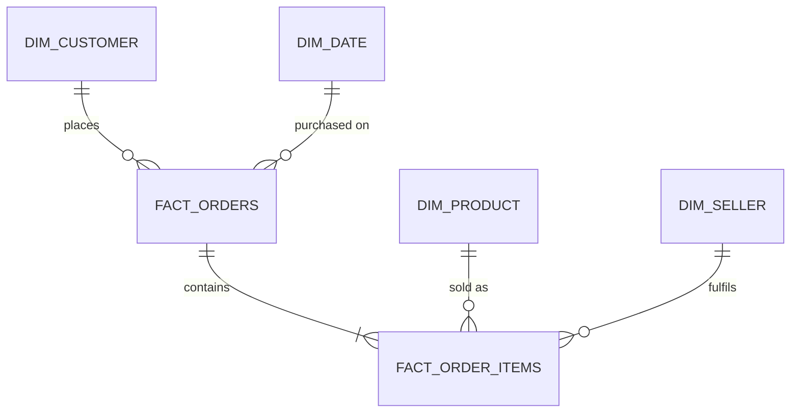

# Olist Delivery Performance & Customer Satisfaction Analytics


> **Status: in progress.** Every number in this README must come from a query in `sql/analysis/` that I have actually run.
> Anything still marked `TBD` has not been measured yet. (Delete this note only when no `TBD` remains.)

## Business question

How much do late deliveries cost a marketplace in **customer satisfaction and repeat business**, and which **sellers, product categories and regions** drive them?

This is framed as a decision for an operations / marketplace-quality team: where should they intervene first?

## Tools

PostgreSQL (CTEs, window functions, star schema) · Power BI (data model, DAX) · Python (data loading and QA only) · Docker

## Headline findings

<!-- Fill ONLY with results from sql/analysis/*.sql. Keep each row to one sentence with a real number. -->

| # | Finding | Evidence |
|---|---------|----------|
| 1 | TBD | `sql/analysis/03_delay_vs_review.sql` |
| 2 | TBD | `sql/analysis/05_seller_scorecard.sql` |
| 3 | TBD | `sql/analysis/04_state_delay_hotspots.sql` |
| 4 | TBD | `sql/analysis/07_repeat_purchase_cohorts.sql` |

## Recommendations

TBD. Written after the analysis, in `docs/memo.md` (one page).

## Dashboard

TBD. Screenshots go in `images/` (Executive overview, Delivery performance, Seller and category scorecards).
The Power BI file is in `powerbi/`. A PDF export is in `docs/dashboard.pdf`.

## Data

- Source: [Brazilian E-Commerce Public Dataset by Olist](https://www.kaggle.com/datasets/olistbr/brazilian-ecommerce) on Kaggle (about 100k orders, 2016 to 2018, 9 CSV files).
- Licence: see the dataset page for its terms (it is published under a non-commercial licence). **The raw CSVs are not included in this repo.** Download them into `data/raw/`.

## Data model



Layers: `raw` (CSVs loaded as text) → `staging` (typed, cleaned views) → `mart` (star schema used by Power BI).
Grain: `fact_orders` is one row per order; `fact_order_items` is one row per order item.

## Metric definitions

| Metric | Definition |
|--------|------------|
| Delivered order | `order_status = 'delivered'` and a delivery date is present |
| Delivery days | Delivered date minus purchase date, in days |
| Delay days | Delivered date minus estimated delivery date, in days. Greater than 0 means late |
| On-time rate | Delivered orders with delay days ≤ 0, divided by delivered orders |
| Review score | 1 to 5. One review per order (the latest, see `docs/decisions.md`) |
| GMV | Sum of item price, excluding freight, for orders that are not cancelled or unavailable |
| Repeat customer | A `customer_unique_id` with 2 or more distinct orders in the dataset |

## Repository structure

```
.
├── README.md
├── PLAN.md                 # build plan (kept for transparency)
├── AGENTS.md               # context file for AI coding assistants
├── docker-compose.yml
├── .env.example
├── requirements.txt
├── sql/
│   ├── 00_raw_schema.sql
│   ├── 01_load_raw.sql
│   ├── 02_staging.sql
│   ├── 03_marts.sql
│   └── analysis/           # numbered analysis queries
├── scripts/                # helper scripts (run SQL, QA checks)
├── powerbi/                # .pbix and exported theme
├── docs/                   # data quality notes, decisions, reconciliation, memo
└── images/                 # dashboard screenshots
```

## How to reproduce

Prerequisites: Docker, a PostgreSQL client (`psql`), Python 3.11+, Power BI Desktop (Windows).

```bash
# 1. Get the data: download the 9 CSVs from Kaggle into data/raw/

# 2. Configure and start the database
cp .env.example .env            # then edit the password
docker compose up -d

# 3. Create schemas/tables and load the raw CSVs (run from the repo root)
export PGPASSWORD=...           # same as in .env
psql -h localhost -U olist -d olist -f sql/00_raw_schema.sql
psql -h localhost -U olist -d olist -f sql/01_load_raw.sql

# 4. Build staging and marts
psql -h localhost -U olist -d olist -f sql/02_staging.sql
psql -h localhost -U olist -d olist -f sql/03_marts.sql

# 5. Run analysis queries in sql/analysis/ and open powerbi/*.pbix
```

## Data quality notes

TBD. Summarised from `docs/data_quality.md` after profiling (duplicates, nulls, orphan keys, inconsistent timestamps).

## Limitations

TBD. Expected topics: the dataset ends in 2018; delay is measured against Olist's own estimated delivery date; reviews are voluntary; the analysis shows association, not causation.

## About

Built by Daisy Phukan as a portfolio project. [LinkedIn](https://linkedin.com/in/daisy-phukan-a401a4228)
