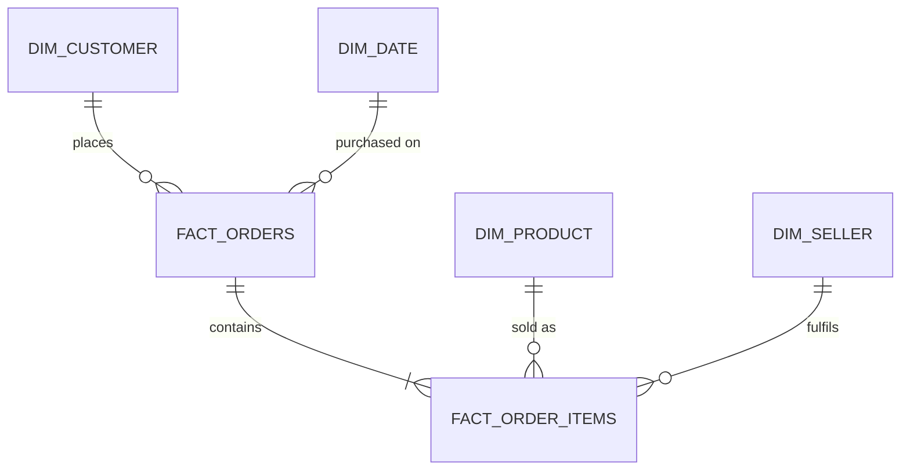

# 📦 Olist E-Commerce: Delivery SLA Analytics & Customer Retention Strategy

[](https://github.com/Daizy-Mgmt/olist-delivery-satisfaction-analytics)
[](https://daisy-olist-analytics.streamlit.app)
[](powerbi/dax_measures.md)
[](sql/)

> 🚀 **Explore the Live Interactive Dashboard:** [daisy-olist-analytics.streamlit.app](https://daisy-olist-analytics.streamlit.app)  
> 📄 **Executive Strategy Memo:** [`docs/memo.md`](docs/memo.md)  
> 📊 **Power BI Build Blueprint:** [`powerbi/POWERBI_BUILD_GUIDE.md`](powerbi/POWERBI_BUILD_GUIDE.md)  
> 📐 **10-Measure DAX Library:** [`powerbi/dax_measures.md`](powerbi/dax_measures.md)  
> 🔍 **SQL & Financial Reconciliation:** [`docs/reconciliation.md`](docs/reconciliation.md)

---

## 🧭 Executive Summary (For Recruiters & Hiring Managers)

In high-growth e-commerce marketplaces, **fulfillment reliability directly dictates customer lifetime value (LTV)**. While marketing teams spend heavily acquiring new buyers, operational friction and delayed shipments quietly erode retention.

This project analyzes **99,441 Brazilian marketplace orders ($13.59M GMV)** across 2016–2018 to answer a core operational challenge:  
**"How severely do delivery delays damage customer satisfaction, and which bottleneck sellers and regional corridors drive them?"**

### 💡 The 4 Big Business Discoveries (TL;DR):
1. **The 8-Day Satisfaction Cliff:** Minor delays (1–3 days) cause a mild rating drop (4.29 ★ ➔ 3.29 ★). However, breaches exceeding **8 days** trigger total customer dissatisfaction: **79.3% of orders receive 1- or 2-star reviews**, collapsing average ratings to **1.70 / 5.0 ★**.
2. **Extreme Bottleneck Concentration (Pareto Rule):** Late orders are not evenly distributed. **10% of active sellers drive 52.5% of all late delivery items**. Managing just ~68 bottleneck sellers resolves over half of all delivery failures marketplace-wide.
3. **The First-Purchase Churn Multiplier:** A bad first impression permanently destroys repeat buying. Customers whose initial order arrived late showed a **44% relative drop in repeat purchases** compared to on-time buyers (1.82% vs. 3.40%).
4. **Severe Regional Disparities:** Deliveries to Southern hubs (São Paulo, Rio de Janeiro) average 8–11 transit days (>92% on-time). Remote Northern states (Maranhão, Ceará, Pará) suffer **19–24 day transit times**, with Maranhão (MA) dropping to **82.6% on-time fulfillment**.

---

## 🎯 4 Data-Backed Strategic Recommendations

From the executive memorandum ([`docs/memo.md`](docs/memo.md)):

* **1. Implement Tiered Seller SLA Gating (Target Top 10% Bottlenecks):** Enforce a 3-strike fulfillment rule for Quintile 5 sellers (>15% late dispatch rate). Require chronic offenders to adopt platform-managed fulfillment or throttle search ranking exposure until their late rate falls below 5%.
* **2. Dynamic Estimated Delivery Date (EDD) Calibration:** Add an algorithmic +3 to +5 day buffer to checkout delivery estimates for Northern/Northeastern zones (MA, CE, PA). Under-promising and over-delivering shifts orders from "Late" to "On Time", protecting customer review ratings.
* **3. Automated Proactive Retention Recovery Vouchers:** Trigger an automated status update with an apology and a 15% discount voucher when orders cross 4+ days past their promised date, re-engaging at-risk first-time buyers before they leave a 1-star review.
* **4. São Paulo Cross-Docking Hub Consolidations:** With >70% of sellers based in São Paulo, partner with regional logistics aggregators to batch cross-state shipments destined for northern transit corridors.

---

## 📊 The 3-Page Power BI Dashboard & Live Web App

The dashboard is designed for executives and operations managers, built with a clean 3-page layout:

| Page | Core Business Question Answered | Key Visuals & DAX Metrics |
|---|---|---|
| **Page 1: Executive KPI Overview** | *How healthy is overall revenue, volume, and fulfillment?* | KPI Summary Cards (`[GMV]`, `[Orders]`, `[AOV]`), Monthly Dual-Axis Revenue Trajectory, MoM Growth % (`[GMV MoM %]`). |
| **Page 2: Delivery & Satisfaction** | *How does logistics performance affect customer sentiment?* | The Satisfaction Cliff Chart (`[Avg Review Score]` vs `Delay Buckets`), State Lateness Rankings (`[On-Time %]`), Repeat Customer Cliff Cards. |
| **Page 3: Seller Bottlenecks & Pareto** | *Where should operations intervene to stop late shipments?* | 80/20 Pareto Cumulative Lateness Curve, Seller Quintile Benchmarks (`NTILE`), Searchable Bottleneck Seller Scorecard. |

* **Live Interactive Version:** [Try the Streamlit Web Application](https://daisy-olist-analytics.streamlit.app) (Zero-install, works on mobile & desktop).
* **Power BI Desktop Blueprint:** Detailed visual layout, color codes, and card settings in [`powerbi/POWERBI_BUILD_GUIDE.md`](powerbi/POWERBI_BUILD_GUIDE.md).

---

## 🏗️ Technical Architecture & Modeling (For Technical Leaders)

### Dimensional Star Schema (`mart` Schema)
To prevent join multiplication (a common pitfall where joining multi-item or multi-payment orders inflates revenue), the raw data was transformed into an optimized dimensional model:



* **`mart.fact_orders` (Grain: 1 row per order):** 99,441 rows. Centralizes order lifecycle timestamps, delay days, delay buckets, review scores, and financial totals.
* **`mart.fact_order_items` (Grain: 1 row per order item):** 112,650 rows. Stores item price, freight, product ID, and seller ID.
* **Dimensions:** `dim_customer` (96,096 unique buyers), `dim_seller` (3,095 sellers), `dim_product` (32,951 items), `dim_date` (1,096 calendar days).

### 📐 Reconciled Financials & Metrics (SQL vs DAX)

Every metric in the dashboard was audited between PostgreSQL and DAX with **zero variance** ([`docs/reconciliation.md`](docs/reconciliation.md)):

| Metric | Business Formula | DAX Measure | Verified Value | Status |
|---|---|---|:---:|:---:|
| **Gross Merchandise Value (GMV)** | Sum of item prices (excl. canceled/unavailable) | `SUM(fact_orders[items_value])` | **$13,591,643.70** | ✅ Exact Match |
| **Total Orders** | Distinct count of order IDs | `DISTINCTCOUNT(fact_orders[order_id])` | **99,441** | ✅ Exact Match |
| **Delivered Orders** | Delivered orders with valid customer date | `CALCULATE([Orders], fact_orders[is_delivered]=TRUE)` | **96,470** | ✅ Exact Match |
| **Average Order Value (AOV)** | GMV divided by Orders using `DIVIDE` | `DIVIDE([GMV], [Orders], 0)` | **$136.68** | ✅ Exact Match |
| **On-Time Fulfillment %** | Orders delivered on/before promised date | `DIVIDE([OnTimeOrders], [Delivered Orders], 0)` | **93.23%** | ✅ Exact Match |
| **Average Review Score** | Deduplicated latest review ratings | `AVERAGE(fact_orders[review_score])` | **4.09 ★** | ✅ Exact Match |

---

## 🛠️ Data Quality & Pitfalls Solved

Empirical audits documented in [`docs/data_quality.md`](docs/data_quality.md) and resolved in `sql/02_staging.sql`:
* **Duplicate Reviews:** 814 duplicate review IDs and 547 multi-review orders resolved by filtering to latest submission (`ROW_NUMBER() OVER (PARTITION BY order_id ORDER BY review_creation_date DESC, review_answer_timestamp DESC)`).
* **Payment Revenue Fanout:** 2,961 orders with multiple payment methods (vouchers, installments) pre-aggregated to 1 row per order before joining fact tables.
* **Timestamp Anomalies:** Flagged 61 orders with delivery preceding approval and 8 orders marked `delivered` without delivery dates.

---

## 💻 How to Run Locally

```bash
# 1. Clone repository
git clone https://github.com/Daizy-Mgmt/olist-delivery-satisfaction-analytics.git
cd olist-delivery-satisfaction-analytics

# 2. Setup database with Docker
cp .env.example .env
docker compose up -d

# 3. Load data & generate Star Schema Marts
pip install -r requirements.txt
python scripts/load_raw_tables.py
python scripts/build_and_verify_marts.py

# 4. Run SQL analysis queries
python scripts/run_analysis_queries.py

# 5. Launch interactive web dashboard
streamlit run app.py
```

---

## 👤 About the Author: Daisy Phukan

* **Current Role:** Technical Project Manager (Promoted from Trainee) — India Business Development at **Agile Robots SE** (Bengaluru, India).
* **Target Roles:** **Business Analyst (BA), Business Intelligence (BI) Analyst, Data Analyst, or Commercial Operations Analyst** (Robotics, Industrial Tech, SaaS, Marketplace).
* **Core Competencies:**
  * **Power BI & BI:** Power BI Desktop & Service (PL-300 Candidate), Advanced DAX (`CALCULATE`, `DIVIDE`, Time Intelligence), Power Query (M), Star Schema Modeling, KPI Scorecards, SQL-to-BI Reconciliation.
  * **Business Analysis (BA):** Requirements Elicitation (30+ CXO/Enterprise Stakeholders), BRD/FRD & User Stories, UAT, Process Mapping, Pricing & Customer ROI Modeling, Financial & GTM Modeling.
  * **Technical Project Management (TPM):** Agile/Scrum Delivery, Sprint Planning, RAID & Risk Registers, SLA Governance, Cross-Functional Engineering Alignment, Jira, Confluence, HubSpot CRM.
  * **Data & Quantitative Analytics:** PostgreSQL (CTEs, Window Functions), Advanced Excel (PivotTables, XLOOKUP, What-If Analysis), Python (`pandas`, `Plotly`, `Streamlit`), Hypothesis Testing.

📬 **Connect:** [daisyphukan.work@gmail.com](mailto:daisyphukan.work@gmail.com) · [LinkedIn Profile](https://linkedin.com/in/daisy-phukan-a401a4228) · [GitHub Profile](https://github.com/Daizy-Mgmt)

