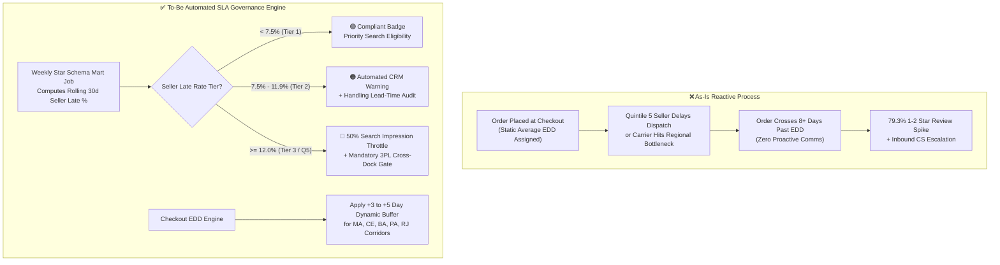

# 📋 Business Requirements Document (BRD): Automated Seller SLA Governance & Dynamic EDD Calibration

**Project:** Olist Marketplace Fulfillment & Retention Optimization  
**Author:** Daisy Phukan (Technical Project Manager / Business & BI Analyst)  
**Status:** Approved for Engineering & Operations Hand-Off  
**Data Backing:** PostgreSQL 15 Star Schema (`mart.fact_orders`, `mart.fact_order_items`) · $13,591,643.70 Reconciled GMV

---

## 1. Executive Summary & Business Case

Empirical analysis of **99,441 Olist marketplace orders** reveals that late deliveries are the single largest controllable driver of negative customer sentiment:
1. **The 8-Day Satisfaction Cliff:** Orders delivered on or before the promised Estimated Delivery Date (EDD) average **4.29 ★** (`9.27%` 1–2★ share). Once a shipment crosses **8+ days past EDD**, customer ratings collapse to **1.70 ★**, with **79.29% of buyers leaving 1- or 2-star reviews**.
2. **Pareto Bottleneck Concentration:** Late orders are not evenly distributed across the merchant base. Among 682 active sellers (`≥30` fulfilled items), the **worst 10% (68 sellers) generate 52.5% of all late items**.
3. **Northern/Northeastern Corridor EDD Mismatch:** Checkout delivery promises fail to account for regional carrier tail latency. While São Paulo (`SP`) achieves **95.51% on-time delivery** (`8.7` avg transit days), Maranhão (`MA`), Ceará (`CE`), Bahia (`BA`), and Rio de Janeiro (`RJ`) experience **82.57%–87.89% on-time rates** due to static checkout estimates.

### Commercial Objective
Reduce marketplace late deliveries by **35%–50% within 2 quarters** without requiring capital-intensive carrier replacements, by implementing:
* **Workstream A:** Automated 3-Tier Seller SLA Governance & Search Throttling in CRM/Marketplace Engine.
* **Workstream B:** Dynamic P85/P90 EDD Buffer Calibration for cross-state Northern/Northeastern routes.
* **Workstream C:** Proactive 4-Day Delay Apology Workflow to deflect 1-star reviews and customer support tickets.

---

## 2. As-Is vs. To-Be Operational Process Architecture



---

## 3. Functional Requirements & User Stories (Agile / Jira Spec)

### Epic 1: Automated Seller SLA Tiering & Enforcement
* **User Story US-01 (Tier-2 Warning Automation):**  
  *As a Seller Operations Manager, I want the CRM (HubSpot/Internal Admin) to automatically flag active sellers (`≥30` items) whose rolling 30-day late delivery rate crosses **7.5%**, so that Seller Success can audit their dispatch lead-time before they reach Quintile 5.*
* **User Story US-02 (Tier-3 Search Throttling & 3PL Gate):**  
  *As VP of Marketplace Operations, I want active sellers with a rolling 30-day late delivery rate **≥12.0% (Quintile 5)** to have their organic search ranking demoted by 50% until they either (a) onboard to platform-managed cross-docking (3PL) or (b) maintain `<5.0%` late rate across 50 consecutive orders.*

#### Gherkin Acceptance Criteria (UAT)
```gherkin
Scenario: Nightly Seller SLA Tier Evaluation & CRM Sync
  Given the PostgreSQL mart.fact_order_items table has completed its nightly refresh
  And a seller has fulfilled >= 30 delivered items in the trailing 90 days
  When the seller's rolling_late_rate_pct is >= 12.0%
  Then the seller_sla_tier attribute MUST update to "TIER_3_BREACH"
  And a high-priority Jira/CRM escalation ticket MUST be generated for Seller Operations
  And the marketplace search service MUST apply a 0.5x impression weight multiplier within 4 hours.
```

---

### Epic 2: Dynamic Corridor EDD Buffer Calibration
* **User Story US-03 (Regional P85 EDD Calibration):**  
  *As a Checkout Product Manager, I want checkout Estimated Delivery Dates (EDDs) for destination states with `<90%` on-time fulfillment (`MA`, `CE`, `BA`, `RJ`, `PA`, `ES`, `PB`) to use the **85th percentile (P85) historical seller-to-state transit duration** (+3 to +5 days over mean), so that customer expectations align with real carrier transit times.*

#### Gherkin Acceptance Criteria (UAT)
```gherkin
Scenario: Dynamic EDD Buffer Calculation at Checkout
  Given a customer in state "MA" or "CE" initiates checkout from a seller in state "SP"
  When the EDD service queries the route transit lookup table
  Then the promised delivery window MUST apply the P85 route transit days (+4 business days buffer)
  And log both baseline_edd and buffered_edd in stg_orders for A/B conversion monitoring.
```

---

### Epic 3: Proactive Delay Recovery & Review Deflection
* **User Story US-04 (Day +4 Breach Trigger):**  
  *As a Customer Experience Lead, I want an automated status update and apology voucher ($15 / 15% off next order) sent the moment an unfulfilled order reaches **4 days past promised EDD**, preventing the customer from crossing the 8-day satisfaction cliff uncommunicated.*

---

## 4. Cross-Functional RACI Governance Matrix

| Workstream / Operational Milestone | BI & Data Analytics (Owner) | Marketplace Ops | Seller Success (CRM) | Core Platform Eng |
|---|:---:|:---:|:---:|:---:|
| **1. Star Schema SLA Mart & Weekly Scorecard** | **R** | **A** | C | I |
| **2. Tier-2 Warning Automation & Lead-Time Audit** | I | C | **R / A** | I |
| **3. Tier-3 Search Throttling & 3PL Onboarding Gate** | C | **A** | **R** | **R** |
| **4. Dynamic EDD Buffer Deployment (Northern Routes)** | **C** *(Calibrate)* | I | I | **R / A** |
| **5. Day +4 Delay Apology Voucher Workflow** | **C** *(Track ROI)* | **A** | **R** | I |

*(**R** = Responsible, **A** = Accountable, **C** = Consulted, **I** = Informed)*

---

## 5. Success KPIs & Guardrail Metrics (Power BI Monitoring)

| Metric Category | Primary KPI / Guardrail | Baseline (Actual) | Target (Q+2) | Measurement Source |
|---|---|:---:|:---:|---|
| **Primary Goal** | Marketplace On-Time Delivery % | `93.23%` | **`≥ 96.00%`** | `DAX: [On-Time %]` |
| **Primary Goal** | 8+ Days Severe Delay Share | `2.97%` (2,862 orders) | **`< 1.20%`** | `mart.fact_orders` |
| **Customer Sentiment** | Overall Marketplace Review Score | `4.09 ★` | **`≥ 4.22 ★`** | `DAX: [Avg Review Score]` |
| **Customer Sentiment** | 1–2 Star Negative Review Share | `14.90%` | **`< 10.50%`** | `03_delay_vs_review.csv` |
| **Commercial Guardrail** | Checkout Conversion Rate (Buffered Routes) | Baseline | **`No drop > 0.3%`** | Checkout A/B Telemetry |
| **Commercial Guardrail** | Active Seller Net GMV Retention | `$13.59M` | **`≥ 98.5% Retained`** | `DAX: [GMV]` |
